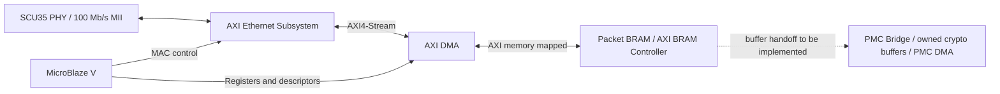

# Moving beyond Ethernet Lite

**A MAC with AXI4-Stream plus AXI DMA is the intended next architecture. It is not implemented or hardware-validated in this lab yet.** The existing reference PDI still uses Ethernet Lite, CPU packet copies and hardened PMC DMA for crypto.

Ethernet Lite exposes packet RAM through a memory-mapped interface, not the AXI4-Stream data ports expected by AXI DMA. AXI CDMA could potentially move data to/from that mapped RAM, subject to its supported access semantics and widths; that has not been tested here and would still leave the Lite buffers, software packet ownership and PMC handoff to manage.

AMD's [AXI Ethernet functional description](https://docs.amd.com/r/en-US/pg138-axi-ethernet/Functional-Description) describes streaming interfaces intended for DMA/FIFO attachment. Its [PHY parameter combinations](https://docs.amd.com/r/en-US/pg138-axi-ethernet/Allowable-Parameter-Combinations) include MII at 10/100 Mb/s.

The local Vivado 2026.1 component metadata lists `xcsu35p` as production-supported for AXI Ethernet 8.0 and its TEMAC dependency. A local SU35P IPI catalog probe instantiated AXI Ethernet successfully, and a separate IP probe accepted MII configuration. These establish catalog/configuration availability, not complete BD validation, an implemented PDI, usable MAC licensing or hardware operation. TEMAC declares a `tri_mode_eth_mac` license feature; do not assume the existing BASIC Vivado license includes it. License-report/output-generation checks are separate gates. Both local probes stalled at those stages and were stopped; this does not establish that a license is absent. See the [scoped probe outcome](evidence/dma_probe.json).

Use a small AXI-accessible packet BRAM, initially 16–32 KiB with aligned descriptors/buffers, rather than assuming the current LMB-only local memory is DMA-accessible. Confirm actual MAC/FIFO/DMA/BRAM utilization and timing before selecting final ring sizes. MicroBlaze local firmware can remain in its existing 128 KiB RAM. No HyperRAM is inherently required for a modest packet ring.

Bring-up stages:

1. Verify MAC licensing/output generation, MII clock/reset constraints and full BD validation for the SU35P.
2. Implement MAC + AXI DMA + packet BRAM with catalog IP; export the XSA and build the matching standalone BSP/software.
3. Prove plaintext packets, descriptors, backpressure, overflow/drop accounting and recovery before adding crypto.
4. Integrate AES/SHA buffer handoff. The current PMC buffers are distinct from packet BRAM: MAC DMA alone does not establish direct DMA into the security engines or eliminate PMC Bridge copy costs.
5. Measure sustained input payload Mb/s, reply traffic separately, drops and latency. A 100 Mb/s link does not imply 100 Mb/s application payload after framing/protocol overhead, nor does DMA alone guarantee line rate.

Short two-request probes on the current Lite image reached 15.5 Mb/s plaintext and 13.5 Mb/s encrypted replies. A subsequent sustained run timed out after 56,192 verified packets and recovered cleanly; its cause remains unestablished. The continuous dashboard therefore uses one request in flight, with presentation delays removed and timing probes amortized over 64-packet batches. See [throughput evidence](evidence/throughput.json) and [dashboard timing scope](DASHBOARD.md).
